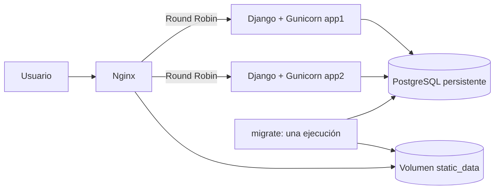

# Conecta UTC — Unidad 4

**Proyecto:** bolsa de trabajo universitaria Conecta UTC. **Unidad:** Saber Hacer Unidad 4 — infraestructura y despliegue. **Alumno:** Yahir Emanuel Martínez González. **Universidad:** Universidad Tecnológica de Coahuila. **Carrera:** Ingeniería en Desarrollo y Gestión de Software. **Materia:** Desarrollo Web Integral. **Docente:** M.A.Y.L. Gabriel Alejandro Reyes Morales.

Conecta UTC reúne estudiantes y egresados con empresas para descubrir vacantes, prácticas profesionales y estadías. Esta rama parte del código de la Unidad 3; no modifica el repositorio anterior ni el servicio en Render.

## Propósito y funcionalidades conservadas

La plataforma conserva el inicio, búsqueda/listado y detalle de vacantes, registro e inicio de sesión, perfiles, roles de estudiante/empresa/administrador, postulaciones, CV PDF, aprobaciones administrativas, catálogos, mapas OpenStreetMap/Leaflet, API Django REST Framework y documentación Swagger/OpenAPI. Revisa `docs/ARQUITECTURA.md` para el inventario de componentes y topología.

## Tecnologías

Python 3.13, Django 6.1, Django REST Framework, PostgreSQL, Gunicorn, Nginx, Docker Compose, WhiteNoise, HTML/CSS/JavaScript, Bootstrap, Leaflet/OpenStreetMap, drf-spectacular, GitHub Actions y Neon como PostgreSQL gestionado disponible para producción.

## Topología local Docker



`app1` y `app2` comparten secreto y `DATABASE_URL`. Nginx es el único servicio publicado; la red de backend no es externa. El contenedor `migrate` aplica migraciones una sola vez y recopila estáticos antes de iniciar las apps. PostgreSQL usa el volumen `postgres_data`.

## Levantar localmente

Requiere Docker Engine y Docker Compose v2.

```sh
cp .env.example .env
# Edita .env: reemplaza SECRET_KEY y POSTGRES_PASSWORD con secretos distintos.
docker compose config
docker compose up -d --build
docker compose ps
```

Abre `http://localhost:8080/`. Healthchecks: `http://localhost:8080/health/` (proceso), `/ready/` (PostgreSQL) y `/api/infraestructura/` (etiqueta real configurada del contenedor). Swagger está en `/api/v1/docs/`, el endpoint público de vacantes en `/api/v1/vacantes/` y admin en `/admin/`.

Para probar distribución Round Robin observada, con `python` disponible en el host:

```sh
python scripts/probar_balanceador.py --requests 20
```

El comando falla si no observa ambas instancias o si alguna petición falla; no inventa ni simula resultados. Para una prueba de caída, ejecuta `docker compose stop app1`, repite el script y después `docker compose start app1`. Nginx detecta y excluye un upstream fallido, pero una petición puede fallar durante esa ventana; registra resultados reales.

Datos ficticios: `docker compose exec app1 python manage.py poblar_demo`. Para crear las cuentas demo, añade `--usuarios` solo en un entorno aislado y configura un secreto `DEMO_PASSWORD` seguro. No publiques usuarios de demo en producción. `docker compose down` conserva datos; `docker compose down -v` los elimina.

## Configuración

Variables Docker locales se documentan en `.env.example`. Nunca se suben `.env`, claves, contraseñas, tokens, CV ni datos reales. En Vercel Production están configurados `SECRET_KEY` (oculto), `DEBUG=False` y `DATABASE_URL` PostgreSQL gestionado. Para un dominio personalizado futuro, añade su hostname exacto a `ALLOWED_HOSTS` y su origen HTTPS a `CSRF_TRUSTED_ORIGINS`. Activa reCAPTCHA y Resend únicamente con credenciales existentes. Los certificados TLS para el host Vercel son administrados por la plataforma.

La aplicación rechaza SQLite cuando `DEBUG=False`. En desarrollo local sin `DATABASE_URL`, settings conserva SQLite para compatibilidad de las pruebas existentes; en Docker se usa PostgreSQL. No apunta a la base de datos de Render de Unidad 3.

## Vercel: producción distinta a Compose

El proyecto `despliegue-docker-conecta-utc` usa runtime Python/Django y Neon PostgreSQL; el deployment Production `dpl_DBJsJESKVoF6TGDwwyARbSmJY7i7` quedó `READY` desde `main` en `381ce420`. La URL pública estable es <https://despliegue-docker-conecta-utc.vercel.app> (TLS 1.3, certificado `*.vercel.app`). Solicitudes HTTP anónimas sin cookies y un navegador en sesión aislada cargaron el sitio; no se desactivó Deployment Protection ni se necesitó dominio personalizado.

Neon Production recibió migraciones y `poblar_demo`; una consulta Django confirmó PostgreSQL y 12 filas de vacantes; el sitio muestra 10 vacantes publicadas. GitHub Actions para `main@381ce42` pasó. El acceso anónimo a la app funciona aunque una llamada `vercel curl` de inspección al deployment específico haya redirigido a SSO; esa respuesta no se reprodujo al solicitar la URL estable sin credenciales. Consulta `docs/DESPLIEGUE.md`, `docs/PRUEBAS.md` y `docs/GUIA_DE_CAPTURAS.md` para resultados y limitaciones.

## Pruebas

```sh
python manage.py check
python manage.py check --deploy
python manage.py makemigrations --check --dry-run
python manage.py test

docker compose config
docker compose build
docker compose up -d
docker compose ps
python scripts/probar_balanceador.py --requests 20
```

GitHub Actions ejecuta checks, migraciones y pruebas contra PostgreSQL. La última ejecución local de Unidad 4 registró 143 pruebas aprobadas; GitHub Actions pasó para `main@381ce42` (run `45519292178`). Se verificaron anónimamente en Production los endpoints de salud, listado, REST y Swagger, además de las páginas GET de login y registro. Los flujos POST no se ejecutaron en producción para evitar crear usuarios de prueba; ver `docs/PRUEBAS.md`.

## Documentación y evidencias

- `docs/ARQUITECTURA.md`: componentes Docker y topología real prevista para Vercel.
- `docs/DESPLIEGUE.md`: Docker, producción y variables.
- `docs/PRUEBAS.md`: comandos, resultados observados y limitaciones pendientes.
- `docs/SEGURIDAD.md`: controles y secretos.
- `docs/EVIDENCIAS.md`: guía precisa de capturas auténticas, sin exponer información sensible.

## Estado real de requisitos

| Requisito | Tecnología/configuración | Estado en esta rama | Evidencia |
| --- | --- | --- | --- |
| Base de aplicación U3 | Django apps/templates y modelos fuente | Importada; 143 pruebas locales aprobadas en esta ejecución | Historial Git + suite |
| Servidor app | Gunicorn en contenedores no root | Dockerfile y Compose versionados; ejecución pendiente (Docker no instalado aquí) | `Dockerfile`, Compose |
| PostgreSQL local | PostgreSQL 16 + volumen | Configurado; no ejecutado por falta de Docker | `docker-compose.yml` |
| Migraciones | Servicio único `migrate` | Ejecutadas en Neon Production; `migrate --check` pasó | Compose y comando Django |
| Balanceo | Nginx upstream Round Robin | Configurado; distribución/failover sin verificar | `nginx/default.conf`, script |
| Health/ready | Django y consulta SQL sin filtrar secretos | `/health/` y `/ready/` anónimos dieron 200; readiness informó DB disponible | `core/views.py`, pruebas Production |
| Seguridad | Entorno, cookies, proxy, HSTS, ignore rules | `SECRET_KEY` oculto configurado; TLS 1.3 validado; dominio estable público | `config/settings.py`, docs |
| CI | GitHub Actions + PostgreSQL | Run `45519292178` pasó para `main@381ce42` | `.github/workflows/tests.yml` |
| API, roles, mapas, Swagger | Implementación heredada de U3 | API de vacantes y Swagger cargaron en Production; 143 tests cubren flujos; no se ejecutaron formularios POST en Production | Código y `docs/PRUEBAS.md` |
| Vercel/Neon | Runtime Vercel + Neon | Deployment `READY` desde main; DB PostgreSQL; 12 vacantes en BD y 10 publicadas | `docs/DESPLIEGUE.md` |
| HTTPS público | TLS administrado Vercel | Certificado `.vercel.app` válido y URL estable accesible anónimamente | `docs/EVIDENCIAS.md` |
| Rendimiento/concurrencia | script stdlib de requests seriales | No ejecutado; Docker ausente y prueba local sin Nginx | `docs/PRUEBAS.md` |

## Repositorios

- Unidad 4: https://github.com/Yahir-Martinez3012/MartinezGonzalezYahirEmanuel-UNIDAD4
- Unidad 3 (solo fuente de importación; no se modifica): https://github.com/Yahir-Martinez3012/MartinezGonzalezYahirEmanuel-UNIDAD3

La URL pública estable actualmente asignada es <https://despliegue-docker-conecta-utc.vercel.app>. Consulta `docs/EVIDENCIAS.md` y `docs/GUIA_DE_CAPTURAS.md` para completar las evidencias académicas verificables.
