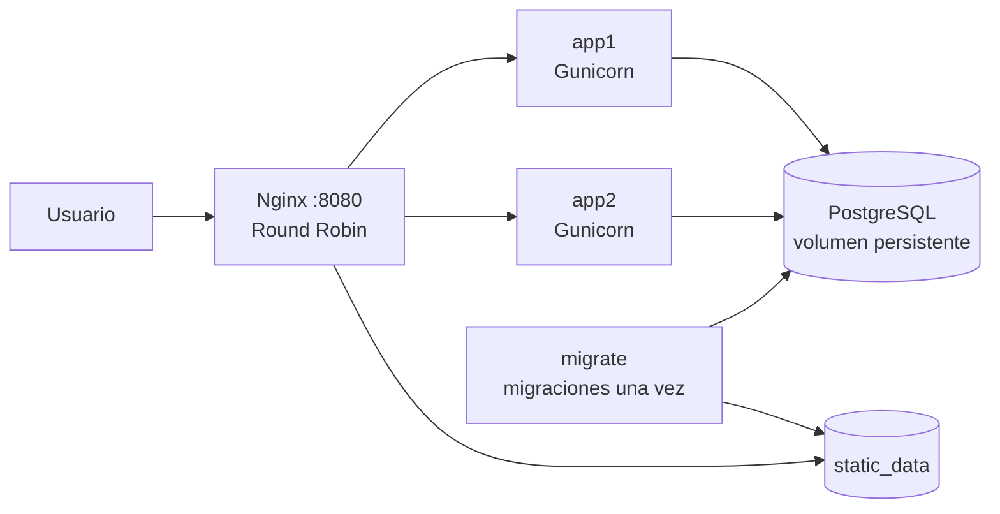
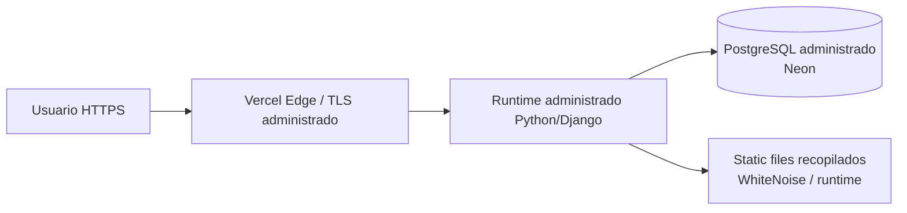

# Arquitectura de Conecta UTC — Unidad 4

## Objetivo

Mantener la aplicación Django original de la bolsa de trabajo UTC e incorporar una forma reproducible de ejecutarla en contenedores con base de datos PostgreSQL, proxy inverso y dos procesos de aplicación.

## Docker Compose

`backend` es una red interna entre aplicaciones y DB; solo Nginx publica un puerto. `migrate` es un servicio de una sola ejecución requerido por ambas instancias, evitando migraciones concurrentes. `static_data` es generado en ese paso y montado de solo lectura en las instancias y Nginx. La persistencia de PostgreSQL vive en `postgres_data`.

Nginx usa Round Robin (predeterminado del `upstream`) y reintentos para fallos de conexión/timeout. Ante una caída abrupta, la primera solicitud puede ser la que detecta el fallo; el proxy excluye temporalmente ese upstream con `max_fails`/`fail_timeout`. Esto no equivale a tolerancia sin errores en todos los casos.

## Producción en Vercel

Este es el diseño de despliegue de Django detectado por Vercel; no despliega el `docker-compose.yml`, no ejecuta Gunicorn de forma permanente y no usa Nginx. La distribución y escalado de funciones corresponden a Vercel. El `DATABASE_URL` de Neon y las variables Django se configuran en el proyecto Vercel, nunca en Git.

## Endpoints de operación

- `GET /health/`: proceso HTTP vivo; no accede a base de datos.
- `GET /ready/`: ejecuta `SELECT 1`; devuelve solo estado genérico y no filtra errores ni credenciales.
- `GET /api/infraestructura/`: versión, hora e identificador configurado; en Compose los valores `app1`/`app2` coinciden con cada servicio.

## Interacciones funcionales

Se conservan las apps Django, templates, modelos, autenticación, permisos por rol, API DRF, Swagger, mapas y comando `poblar_demo` importados de Unidad 3. La carga de CV existente se realiza en base de datos según la implementación fuente; no se depende de disco efímero para esos archivos.
